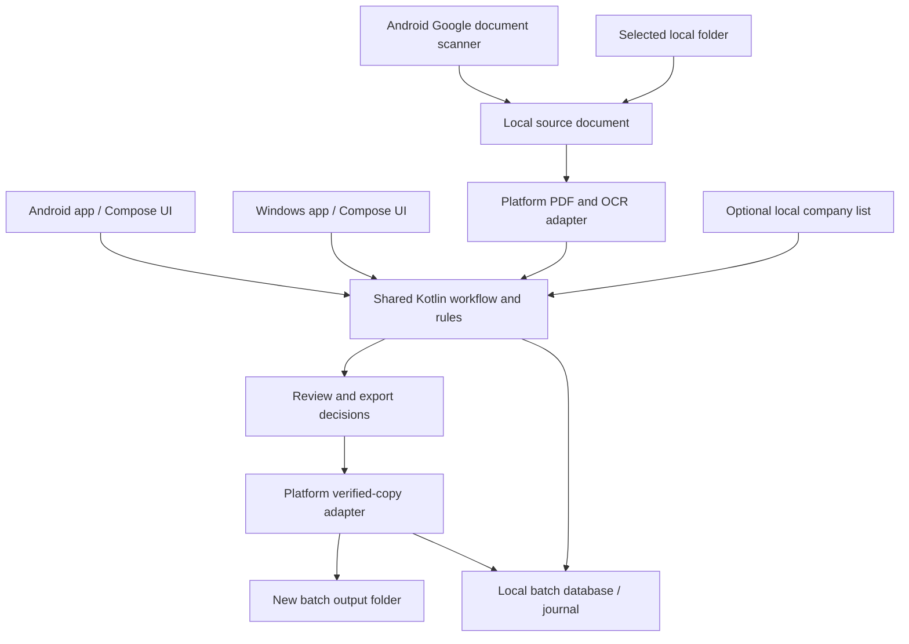

# SEC document naming application — consolidated plan for review

This is the current product plan for user review. It supersedes conflicting platform, scanner, and in-place rename proposals in the earlier [implementation plan](./IMPLEMENTATION_PLAN.md). It records decisions, not completed functionality.

### Decisions confirmed after review

- Deliver and validate Android first, then Windows, keeping the shared Kotlin Multiplatform architecture from the start.
- Use bundled Google ML Kit Text Recognition on Android and local Tesseract on Windows, subject to bank approval of the dependencies. Google Document Scanner remains the Android camera scanner.
- First physical demo/test device: the user's Samsung Galaxy S23 Ultra. Its currently installed Android/One UI version is not yet known; record those versions during device testing rather than infer them from the model's original specifications.
- The client's deployment target is a single tablet, with model, operating-system family, and version still unknown. Validate that device before deployment; successful S23 Ultra testing does not certify the eventual tablet.
- Continue Android-first development for the S23 Ultra demo. If the client tablet is Android, validate layout, performance, scanner availability, and file access on it. If it is an iPad, add an iPadOS target with Apple-specific capture/OCR/storage and a separate build/signing/distribution process; this is additional implementation, not an APK configuration change. Windows remains the later agreed target; iPadOS is conditional, not yet committed release scope.
- Use explicit compatibility gates and validate devices before claiming support; do not require a final tablet inventory to start the Android demo.

### Installation and compatibility policy

- Android 8.0/API 26 is the provisional app minimum, matching the existing feasibility configuration. This is a development baseline, not a promise that every Android 8+ device is supported. Dependency compatibility, scanner requirements, device testing, and bank deployment policy may adjust the baseline.
- Set the app minimum in the Android build so the package manager rejects installation on older Android versions. Do not set a maximum Android version merely because a newer version has not yet been tested.
- For direct APK distribution, aim for one signed universal APK containing all native architectures supported by the chosen libraries. Audit its actual architecture contents. A Google Drive link is a file link: it does not detect a device and choose a compatible build, and users may download a file their device cannot install. Store-based distribution can select architecture-specific packages later if adopted.
- Check Google Play services availability and scanner initialization at runtime. Show actionable messages for missing/outdated services, resource preparation, unsupported devices, and insufficient hardware. Google documents a 1.7 GB minimum total RAM for its scanner; passing that threshold alone does not establish full application compatibility.
- If camera scanning is unavailable, keep local file import available when the app and bundled OCR can run. Do not block all document processing solely because the optional scanner is unavailable.
- Package Android OCR data for offline use from installation. Scanner resources may need an initial download through Google Play services; subsequent offline operation depends on their continued availability.
- The later Windows release will declare and test its own OS and CPU requirements before publishing an installer; no desktop compatibility promise is made yet.

Sources: [Android minimum SDK installation behavior](https://developer.android.com/guide/topics/manifest/uses-sdk-element), [Google scanner requirements](https://developers.google.com/ml-kit/vision/doc-scanner/android).

## 1. Goal

Automatically name scanned SEC documents using the certificate holder's company name. Create renamed copies in a new output folder while preserving every imported source document unchanged. Process documents locally on Android or Windows, without a web server or cloud document-processing service.

## 2. Confirmed decisions

| Area | Decision |
| --- | --- |
| Platforms | Standalone Android phone/tablet app and Windows desktop app |
| Language and UI | Kotlin Multiplatform + Compose Multiplatform |
| Input | Existing scanned PDFs/JPGs/PNGs; Android camera scanning or gallery import within the scanner |
| Camera scanner | Google ML Kit Document Scanner on Android; initial resource download through Google Play services is acceptable |
| Processing | On-device OCR and company-name extraction; no document upload feature |
| Company reference list | Optional; CSV/Excel list can be imported locally when available |
| Source handling | Read-only application behavior; never rename, move, delete, or rewrite imported originals |
| Output | User selects a separate output parent; app creates a new batch folder with renamed copies |
| Duplicate names | Base filename, then `(1)`, `(2)`, etc.; never overwrite existing files |
| Visual direction | PSBank-inspired blue/red on white, with neutral backgrounds and explicit status text |

## 3. User workflows

### Import existing scans — Android and Windows

1. Select the source folder and a separate output parent. Source selection does not start processing. Subfolder scanning is off by default.
2. Optionally import a company list or use the previously imported local list.
3. Analyze supported documents, with progress and cancellation at safe boundaries.
4. Inspect proposed company names, evidence, output names, and decisions. Correct or approve uncertain results.
5. Export accepted items into a uniquely created batch folder under the output parent.
6. See verified-copy, review-pending, failed, and incomplete counts. Reopen a batch to reconcile or resume unfinished operations.

Reject source/output equivalence and output locations inside the source. Resolve filesystem links and Android document identities where possible; do not silently proceed if locations cannot be safely distinguished. Prefer bank-approved local device storage for the initial release.

### Capture documents — Android only

1. Tap **Scan document**.
2. If Google scanner resources are unavailable, show setup/readiness guidance and request the client to connect for initial preparation. Handle unsupported devices and preparation failures without losing imported work.
3. Capture pages or use the scanner's gallery button to choose existing photos, adjust cropping/rotation, and confirm the scan. Gallery originals remain unchanged; the scanner creates a processed PDF.
4. Preserve the scan returned by the scanner as the source digital document, then use the same extraction/review/export pipeline as imports.

The Google scanner produces processed JPEG/PDF results; we must not promise access to untouched camera-sensor photos through that API. Raw-photo archival is a separate feature, not part of this plan. Retain confirmed scan sources locally under an explicit retention policy; the user can export a source archive if app-private storage would otherwise be the only copy. Uninstalling an app can remove its private source files. Do not automatically save captures to a cloud-synced gallery.

After preparation, scanning is expected to work offline on supported devices while required components remain available. A reset, cleared Play services data, or unavailable components can require preparation again. Do not promise a lifetime one-time download.

## 4. Extraction and company matching

Support now covers both incorporation-certificate clauses and Secretary's Certificates. For Secretary's Certificates, identify the company in the introductory “Corporate Secretary of …” declaration before the certification/resolutions, excluding bank mentions and signatories later in the document. The rebuilt `0.2.1-demo` APK includes this logic; the previously delivered `0.2.0-demo` APK does not. Device retesting remains pending for these extraction updates.

1. Recover usable PDF text where a suitable local library supports it; otherwise render/OCR pages. Bound file size, page count, image dimensions, and memory use.
2. Find certificate-holder candidates using SEC wording, surrounding text, and layout. Support multiline names. Company suffixes support a candidate but do not establish identity alone.
3. When a list is present, compare normalized names and aliases. Preserve official display spelling for output; sanitize only characters/path features that cannot be used in filenames.
4. Suggest approximate matches for review. Never select the nearest name automatically merely because it has the highest similarity score.
5. If the document has multiple plausible holders, conflicting names, illegible text, or no match, require review. Version one assumes one company/certificate per file. It does not split mixed-company PDFs automatically.

The initial validation mode requires approval before export. Automatic export of clear matches is the target behavior after extraction rules are validated against representative documents. Similar names, uncertain OCR, unknown companies, and fuzzy suggestions stay in review. Present decision reasons rather than uncalibrated confidence percentages.

Company-list import includes a preview, column mapping, official name, optional aliases, and duplicate/ambiguity validation. No email-account integration: users save the attachment locally and import it. Importing a list can recheck pending items; it does not silently change completed outputs.

## 5. Output safety and recovery

Example:

```text
Source folder (unchanged)       New batch output folder
scan001.pdf                    NORTHSTAR CORPORATION.pdf
scan002.pdf                    NORTHSTAR CORPORATION (1).pdf
scan003.pdf                    RIVERBEND SERVICES INC.pdf
```

- Copy original source bytes; do not replace them with OCR or image-enhancement derivatives. Preserve original file extensions.
- Pin the content identity used during analysis; detect changes before export. Hash while copying, then reopen and hash output to verify it matches the source snapshot.
- Keep incomplete copies identifiable and never label them complete. Publish final names after verification where the storage provider permits; test and document provider-specific limits.
- Allocate duplicate numbers against both planned and existing names, recheck at execution, and use exclusive creation where available. If a provider cannot support the promised behavior, fail clearly or restrict support to tested local providers.
- Persist an operation journal before writing. Reconcile pending/uncertain entries after interruption; do not blindly retry a potentially completed operation.
- Report insufficient space, access loss, locked/corrupt/encrypted inputs, cancellation, and verification failures per item.
- Resume batches explicitly. Repeated exports start a new batch only when requested, rather than silently multiplying copies.
- No source rollback is needed because source files are not modified. Initial recovery uses batch history and verified outputs; automatic deletion or rollback of completed exports is excluded from the first release.

## 6. Architecture and proposed remaining components



Shared: name extraction, normalization, list matching, decisions, naming, batch state, and adaptable Compose screens.

Platform-specific: camera scanning, PDF rendering/OCR, location permissions, file copying/publication, packaging, and OS integration. Both apps work independently; no synchronization or local web service is required.

Application-owned source is Kotlin throughout. Shared UI and rules belong in `shared/src/commonMain/kotlin`; Android implementations belong in `app/src/main/kotlin`. The Android folder/OCR adapters have been converted from the initial Java prototype, and the unused Java naming implementation has been removed. Legacy behavior tests now target the single shared Kotlin extractor. JDK/Android SDK tooling and Java/native third-party dependencies remain normal platform requirements; they do not introduce Java source as an application architecture requirement.

```text
shared/src/commonMain/kotlin/   Shared extraction, naming, state models, Compose UI
shared/src/commonTest/kotlin/   Shared behavior tests, including original naming contracts
shared/src/desktopTest/         JVM regression fixtures and dataset tests
app/src/main/kotlin/            Android activity/state, scanner, OCR, storage/export adapters
app/src/test/kotlin/            Android-module JVM tests for copy integrity
```

The JDK is required on the development computer to build Android/JVM targets; users do not install a separate Java runtime on the phone. Kotlin source may import `java.io` or other JVM APIs in Android-specific code. Those imports are platform-library calls, not handwritten Java source. Keep such dependencies out of common code so the shared layer stays portable.

Proposed implementation components subject to dependency validation:

- Coroutines and state-based screen models for responsive processing.
- Local SQLite database through a Kotlin Multiplatform-compatible persistence library; evaluate Room Multiplatform compatibility with both targets before pinning versions.
- Android bundled Latin OCR using ML Kit Text Recognition, approved as the implementation choice subject to bank dependency approval. This is separate from Google Document Scanner and avoids first-use OCR model downloads. It is proprietary.
- Windows local OCR using Tesseract with packaged language data, approved as the implementation choice subject to bank dependency approval. Do not assume Android ML Kit works on Windows.
- Local PDF rendering and CSV/XLSX readers selected for compatibility, license, memory use, and safe parsing. Pin tested versions.

Kotlin/Compose and the OCR engine combination are chosen. Specific database, PDF, spreadsheet libraries, and dependency versions remain engineering selections to validate.

## 7. Screens and visual design

1. **Home:** Android Scan button plus import folder, optional list import, output selection, and recent batches.
2. **Batch:** processing progress, original/proposed names, filters, decision reasons, and export summary.
3. **Review:** source page preview, nearby extracted evidence, editable accepted name, company-list suggestions, and output filename.
4. **Company list:** import preview, field mapping, alias/duplicate checks, and recheck pending items.
5. **History/settings:** batch results, recovery, retention, supported storage locations, and scanner readiness.

Use a spacious two-pane review on Windows and larger tablets; use stacked pages/cards on phones. Provide keyboard navigation on desktop, readable contrast, and statuses that do not depend on color alone.

PSBank's published materials use blue/red branding. The initial interface direction is blue for primary controls/navigation, red for restrained brand accents, white cards, and neutral page surfaces. Keep warning/error/success meaning distinct from decorative brand red. Exact official digital color specifications have not yet been verified; final hex tokens and preview recoloring are pending. Do not describe sampled/third-party hex values as an official brand standard.

Research references: [PSBank official annual report](https://www.psbank.com.ph/media/9675/psbank-2025-annual-report.pdf), [PSBank 2023 annual report](https://www.psbank.com.ph/media/7891/2023-psbank-annual-report.pdf).

## 8. Security and backup requirements

- No document-upload endpoint, remote OCR, telemetry, email integration, or automatic synchronization.
- Remove app network permissions on Android where compatible, inspect the merged release artifact, and test the complete flow offline. Google Play services is a separate component with network access for resource delivery; our app's permission removal does not restrict that service.
- Request selected-location access rather than broad device access. Implement source access through read/list-only services even if the OS provider grants additional capabilities.
- Disable Android automatic app backup for the initial release. Keep journals private; full OCR text and images do not belong in routine logs. Define temporary-data and captured-source retention separately.
- Exports inherit their destination access controls. Prefer bank-managed encryption, device locks, and approved destinations. Cloud-synced folders can upload independently of our app and are not approved by default.
- Normal local history is traceable but not tamper-proof. Additional centralized audit or mandatory app authentication would need bank policy input.
- Sign and distribute builds through an approved channel. A link may distribute the APK without being used to host any client documents. Whether Google Drive is an approved distribution channel is a bank deployment decision.
- Source preservation is not an independent backup. Separate encrypted backups and tested restoration remain part of the bank's backup process; add no automatic cloud backup.
- Validate untrusted PDFs/images/spreadsheets and dependency licenses. Do not execute macros or document scripts.

## 9. Delivery sequence and acceptance

1. **Architecture reset:** use the agreed Kotlin Multiplatform structure with Kotlin application source throughout, separate shared/platform adapters, and source-preserving export-copy behavior. Keep the visual preview aligned with source/output selection and researched color tokens.
2. **Android-first feasibility build:** establish the toolchain, build a minimal APK, verify local OCR/PDF handling and real storage-provider behavior. Test minimum-version installation checks, native-library packaging, scanner initialization from a sideloaded APK, and import fallback when camera scanning is unavailable. Implement and validate the Windows adapters and package after the Android milestone.
3. **End-to-end verified export:** existing files -> extraction -> review -> collision-safe copy -> hash verification -> journal, on both platforms.
4. **Camera/list/batch features:** integrate scanner flow, optional company-list import, multi-document progress, interruption recovery, and responsive review screens.
5. **Validation and release:** labeled representative certificate evaluation, offline checks, artifact permission/network inspection, security review, installation testing, and signed packages. Enable validated automatic eligibility only when evidence supports it.

Acceptance includes unchanged source names/content hashes, verified output content, no overwrites, recovery after interruption, duplicate numbering, unsupported/corrupt input handling, source-change detection, optional list import, and Android camera scanning in airplane mode after setup. Record extraction error rates and review rates; do not promise accuracy before measurement.

## 10. Current status and remaining inputs

An updated Android demo APK (`0.2.4-demo`, approximately 51.5 MiB, version code 6) has been built successfully with shared Kotlin Multiplatform naming rules and Compose UI. It implements scanner integration with camera or existing-photo selection, local folder import/OCR, expanded incorporation/Secretary's Certificate extraction, editable review, first-page preview, verified-copy export to a separate batch folder, and local history. Its presentation now includes a guided import/review/export layout, persistent status panel and recovery actions, OCR page progress, inline name validation, visible save prerequisites, verified-copy receipts, and dated completed/incomplete history. Application-owned source and tests are now entirely Kotlin, including the read-only source/OCR adapters. The earlier in-place rename action and unused Java extractor have been removed.

Verification: 49 automated tests passed (28 shared rule cases, 3 dataset regression tests covering the ten synthetic PDF transcripts and two Secretary's Certificate excerpts, 7 legacy naming contracts now tested in Kotlin, 6 export-readiness checks, and 5 copy-integrity checks). Android lint completed with 0 errors and 6 non-blocking warnings (four dependency-update notices and two optional KTX-style suggestions). The built APK's signature verifies, and package inspection confirms minimum API 26, target API 35, arm64-v8a/armeabi-v7a/x86/x86_64 native libraries, and no app internet/network-state permissions. App backup exclusions are configured. These checks do not establish Android OCR accuracy on the physical device or a production security review.

The user tried the previous APK on the S23 Ultra and reported missed company names. Installation/retesting of the updated extraction, scanner initialization, local storage behavior, and airplane-mode verification still need recorded device results. Part 1 remains the OCR/rules baseline; the proposed on-device language-model fallback is deferred to part 2 after baseline validation. Company-list import, full batch automation/recovery, Windows packaging, and any iPadOS target remain future work. The HTML is a fictional design preview. See [DEMO_GUIDE.md](./DEMO_GUIDE.md) for device instructions and [README.md](./README.md) for build details.

Needed during validation: representative approved certificate samples, target Android devices/versions, Windows installation restrictions, bank dependency/security requirements, and the company list when available. None requires uploading sensitive documents into this chat.

Official technical references: [Compose Multiplatform](https://kotlinlang.org/docs/multiplatform/compose-multiplatform.html), [Google Document Scanner](https://developers.google.com/ml-kit/vision/doc-scanner/android), [on-device scanner flow](https://developers.google.com/ml-kit/vision/doc-scanner), [model installation options](https://developers.google.com/ml-kit/tips/installation-paths).
