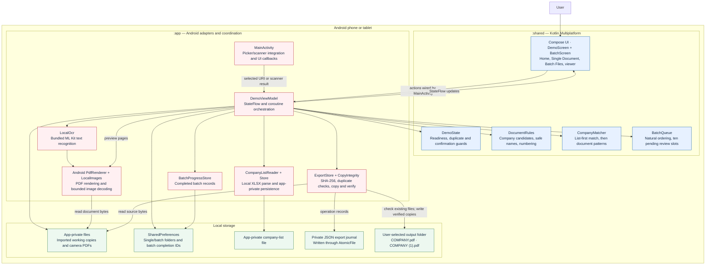
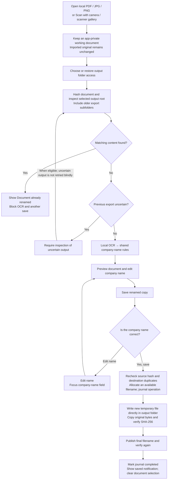

# SEC Rename — current architecture

Proposed next phase: [document understanding and selectable-field research](./DOCUMENT_UNDERSTANDING_RESEARCH.md). That proposal is separate from the implemented architecture below.

Implemented Android demo: **0.5.1-demo** (version code 21). Checked against the source on **2026-11-10**.

Open this file in VS Code and press **Ctrl+Shift+V** for Markdown Preview. Current VS Code versions render the Mermaid diagrams below. For a separate offline diagram editor, draw.io Desktop can import Mermaid through **Arrange → Insert → Mermaid**.

## 1. System overview

The application runs on the Android device. Compose Multiplatform provides the shared UI; an Android ViewModel coordinates local document access, OCR, review, and verified export. Shared Kotlin rules identify company-name candidates from OCR text. The user confirms the name before a copy is saved directly into the selected output folder.

Before a source action, the ViewModel validates the remembered destination. The shared `InputRequest` records the requested camera/file action and folder-selection step in memory. Missing or inaccessible destinations show a contextual folder prompt. MainActivity consumes picker/source launches once, only while resumed and after validation is idle. A validated folder resumes the original action; cancellation, picker failure, genuine backgrounding, and process death do not leave a persisted action to launch later. Activity recreation retains the in-memory request and Android result registration. Manual Save copies to changes the destination without launching an input action.

The current document is a memory-only session. Successful export or genuine Activity backgrounding clears its attachment, company name, OCR evidence, viewer, and review state; the remembered destination and export journal remain. A three-second Material Snackbar appears above the footer. The Scaffold bottom bar measures it into content padding only while visible, keeping controls uncovered and leaving no permanent message slot. Managed pickers/scanner and configuration changes preserve the active review. Late document results are ignored, while already-started verified output writing may finish safely. Retired imported working copies are cleaned up after readers close, except sources protected by unresolved/unreadable journals. Camera working PDFs are removed only after a new verified export and completed journal; failed/unexported and older retained scans remain. Originals and exported outputs are outside cleanup scope.

The arrows show calls and data access, rather than a network topology. The foreground batch review is implemented, but active OCR/name edits are not restored after process death. The ViewModel and file/OCR adapters remain Android-specific; sharing UI and rules does not yet provide a finished Windows application.

## 2. Document processing flow

An invalid name, failed duplicate check, missing folder access, or operation already in progress blocks saving. Confirmation applies to the current document, company name, proposed filename, destination, and review revision. Dismissing the dialog does not save. If copying or publication cannot be verified, the journal records an incomplete operation and the user must inspect the output before retrying.

A completed export record whose matching bytes are no longer found does not require a warning or recovery confirmation. After successful destination inspection, the document follows normal reading, filename review, and save confirmation. Previous export records remain intact; duplicates are checked again before saving. Access/read failures do not count as successful inspection.

Filename collisions between **different documents** receive `(1)`, `(2)`, etc., based on existing names in the selected folder. The receipt reports the actual saved filename. Identical bytes are blocked by duplicate detection even if their filename differs. Re-photographing a document can produce different bytes and is not guaranteed to be detected as the same document.

## 3. Files and responsibilities

| Component | Current source | Responsibility |
| --- | --- | --- |
| Shared screens | [DemoScreen.kt](shared/src/commonMain/kotlin/com/local/secrename/shared/DemoScreen.kt), [BatchScreen.kt](shared/src/commonMain/kotlin/com/local/secrename/shared/BatchScreen.kt), [CompanyListControls.kt](shared/src/commonMain/kotlin/com/local/secrename/shared/CompanyListControls.kt) | Compose home, single-file and batch workflows, list import, review cards, preview, confirmation, history, and notices |
| Shared state and guards | [DemoState.kt](shared/src/commonMain/kotlin/com/local/secrename/shared/DemoState.kt) | UI state, duplicate policy, readiness, confirmation snapshot |
| Extraction and filenames | [DocumentRules.kt](shared/src/commonMain/kotlin/com/local/secrename/shared/DocumentRules.kt) | Certificate-context rules, candidate names, filename sanitization, numbered names |
| List-based company matching | [CompanyMatcher.kt](shared/src/commonMain/kotlin/com/local/secrename/shared/CompanyMatcher.kt), [CompanyListReader.kt](app/src/main/kotlin/com/local/secrename/CompanyListReader.kt) | Locally parse XLSX sheets and match holder-clause candidates against the selected company column; ambiguous matches stay editable |
| Batch queue | [BatchQueue.kt](shared/src/commonMain/kotlin/com/local/secrename/shared/BatchQueue.kt), [DemoViewModel.kt](app/src/main/kotlin/com/local/secrename/DemoViewModel.kt) | Natural-order source listing, concurrent analysis of the first ten pending files, per-file save, duplicate skipping, and slot refill |
| Batch progress | [BatchProgressStore.kt](app/src/main/kotlin/com/local/secrename/BatchProgressStore.kt) | Local saved/skipped completion IDs scoped to the source and output folder pair |
| Android entry point | [MainActivity.kt](app/src/main/kotlin/com/local/secrename/MainActivity.kt) | Android lifecycle, local file/folder pickers, Google scanner launch, saved-folder navigation, UI wiring, screenshot protection |
| Workflow coordinator | [DemoViewModel.kt](app/src/main/kotlin/com/local/secrename/DemoViewModel.kt) | StateFlow, foreground operations on IO coroutines, private imports, output-setting restoration, document-session reset, OCR and export orchestration, preview rendering |
| OCR adapter | [LocalOcr.kt](app/src/main/kotlin/com/local/secrename/LocalOcr.kt) | Bundled Latin-script ML Kit OCR; PDF pages rendered locally before recognition |
| Image adapter | [LocalImages.kt](app/src/main/kotlin/com/local/secrename/LocalImages.kt) | Bounded local image decoding and EXIF orientation |
| Document types / folder adapter | [Documents.kt](app/src/main/kotlin/com/local/secrename/Documents.kt) | Supported document metadata, natural-order listing, and read-only folder access for batch input |
| Export and history | [ExportStore.kt](app/src/main/kotlin/com/local/secrename/ExportStore.kt) | Local folder access, recursive duplicate inspection, available names, staged copy publication, durable JSON records |
| Byte integrity | [CopyIntegrity.kt](app/src/main/kotlin/com/local/secrename/CopyIntegrity.kt) | Bounded streaming, SHA-256, reject changed content |
| Private-copy cleanup | [PrivateCopies.kt](app/src/main/kotlin/com/local/secrename/PrivateCopies.kt) | Canonical-path scoped import cleanup; hash-checked camera cleanup after verified export; preserves originals, outputs, and journals |
| History dates | [HistoryDates.kt](app/src/main/kotlin/com/local/secrename/HistoryDates.kt) | Local day keys/dividers and time labels; completed timestamp for new exports, legacy time fallback |
| Privacy configuration | [AndroidManifest.xml](app/src/main/AndroidManifest.xml), [backup_rules.xml](app/src/main/res/xml/backup_rules.xml), [data_extraction_rules.xml](app/src/main/res/xml/data_extraction_rules.xml) | Exclude app network permissions, disable app backup and exclude private data from backup/transfer |
| Build and emulator | [Build-Android.ps1](scripts/Build-Android.ps1), [Run-AndroidDemo.ps1](scripts/Run-AndroidDemo.ps1) | Compile shared/Android modules, tests, lint, APK and emulator deployment |

## 4. Storage and service boundaries

| Location or service | Current behavior |
| --- | --- |
| Original input | Read for a verified private import; the app does not rename or overwrite it |
| App-private `imports/` and `captures/` | Unused imports are retired asynchronously after readers finish and swept at cold start when journals allow it. Newly exported camera PDFs are removed only after verified publication and a final source-hash check. Failed/unexported and older retained captures remain; cleanup failure keeps the file |
| `local-workflow` SharedPreferences | Remembers Single and Batch folder URIs plus batch completion/skipped IDs. Current OCR text, editable names, and confirmation state are not restored |
| App-private `exports/*.json` | Permanent local journal, without expiry or a 30-row cap. New exports record completedAt; legacy time/file-date fallback is supported. Metadata is loaded on IO, ordered by export time, then exposed in 50-entry pages with lazy rows and local-date dividers. Uninstall/app-data clearing still removes these records |
| Selected output folder | Completed renamed copies directly in this folder; older subfolders are preserved and searched for duplicates; incomplete temporary files may remain after failure |
| UI memory | Current OCR evidence, preview bitmap, inline issue, transient save receipt and confirmation; no notification list or unread count. History entries reconstruct their own saved-file/folder URIs from persistent completed export records |
| Google Play services scanner | Separate Google component supplying scanning/gallery capture; initial resource preparation may need connectivity. The app's own network-permission restrictions do not control Play services |
| OCR and preview | Local bundled recognition, Android rendering, and basic ZoomImage without a network image loader |

**Check file**, available on completed history entries and the bottom Snackbar, asks a compatible Android file manager to show the recorded saved folder, with a separate local read-only document-browser fallback. The Snackbar appears above Export history / About in the measured Scaffold bottom bar; its three-second accessibility-aware timer pauses while held or hidden behind a viewer/history/about dialog. The title stays visible. Measured body padding and adaptive scrolling protect controls in constrained windows. It displays only File saved and the action, without a floating overlay. Full filenames and destinations remain in history. History uses the saved file's actual parent, including legacy export subfolders; it never substitutes the currently selected output. Incomplete records and records without usable destination metadata have no file action. An export record does not prove present-day existence; missing folders and expired access produce inline issues. Browser results are ignored and never change the remembered output. Leaving for the file manager follows the normal background rule and clears any active review. Highlighting a particular file is file-manager-dependent and is not promised.

There is **no app backend, cloud OCR endpoint, analytics integration, or local web server** in the implemented architecture. The app's Android manifest removes Internet/network-state permissions. Storage providers and Google Play services are separate components; these controls alone are not a bank production-security certification.

## 5. Implemented versus planned

| Implemented now | Planned / not implemented |
| --- | --- |
| Android Single Document and foreground Batch Files workflows | Background processing and restoration of in-progress OCR/name edits |
| Shared Compose UI and Kotlin rules; Android and JVM shared targets | Packaged Windows application and desktop OCR/file adapters |
| OCR text + deterministic certificate rules + optional company-list matching + human confirmation | Selectable-field extraction for arbitrary document types and local language-model fallback |
| Remembered output; empty document area after saving or backgrounding | Automatic resumption of an interrupted OCR page or uncertain export |
| Local hash checks and copy verification | Measured real-world extraction accuracy and bank production acceptance |
| Android app | iOS target/app |

This is a ViewModel-driven prototype with shared UI/rules and Android adapters. The Android coordinator still owns several workflow, storage, and rendering concerns. A later Windows implementation will need those platform operations behind reusable interfaces; a fully separated cross-platform workflow layer is not already present.

## Viewing and editing

- **VS Code + this Markdown file:** simplest for reviewing the architecture next to its code; open Markdown Preview with **Ctrl+Shift+V**. Update VS Code if an older installation shows Mermaid as text.
- **draw.io Desktop:** useful for offline drag-and-drop editing and client presentation. Import a Mermaid block using **Arrange → Insert → Mermaid** and save an editable `.drawio` file locally.

References: [VS Code Markdown and Mermaid preview](https://code.visualstudio.com/docs/languages/markdown), [draw.io Desktop and offline Mermaid conversion](https://www.drawio.com/docs/security/desktop-secure-diagrams/).
