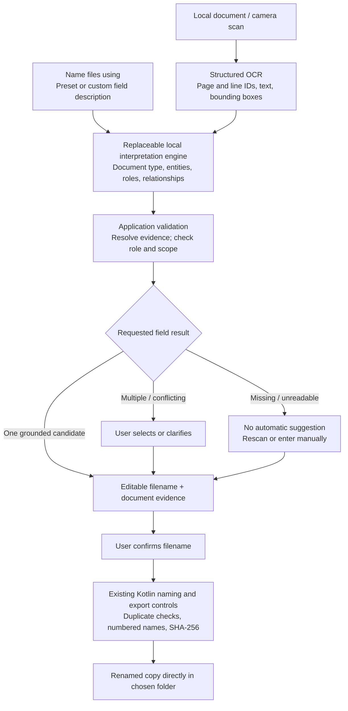

# Research: document-driven filenames and selectable fields

Research date: **2026-11-01**. Status: **proposed upgrade**, based on primary project documentation. No candidate model has been benchmarked on the S23 Ultra or client tablet. The existing Android app remains the company-name OCR/rules implementation.

## 1. The requested capability

Keep the existing goal of saving a renamed copy while allowing the user to choose the document field used for its name. Company name becomes the default preset, alongside choices such as collector, corporate secretary, certificate subject, or a custom field description.

This involves several different tasks:

| Task | Example | Why it matters |
| --- | --- | --- |
| Document classification | Secretary's Certificate, birth certificate, collection authorization, unknown | Establish the document's likely context; allow correction and unknown results |
| Entity extraction | ABC SOLUTIONS INC. is an organization; Maria Regala is a person | Find values rather than treating every capitalized phrase as a filename |
| Role extraction | Maria is the corporate secretary; Juan is an authorized collector | Distinguish people named in different capacities |
| Relationship extraction | Maria is secretary **of ABC SOLUTIONS INC.** | Associate the correct person with the correct organization |
| Request interpretation | “Collector's full name” | Identify which grounded value the user wants |
| Filename composition | Juan Dela Cruz.pdf | Convert the reviewed value into a safe filename through application code |

Recognizing a person or organization does not establish their role. A secretary is not automatically a collector. Likewise, on a birth certificate the child's name, parents' names, and registrar's name must remain separate.

## 2. Open-source shortlist

These are complementary systems and components. None was verified as a ready-made native Android application implementing our entire workflow.

| Project | Verified capabilities | Fit for our project | Code license listed by project |
| --- | --- | --- | --- |
| [Paperless-ngx](https://github.com/paperless-ngx/paperless-ngx) | Document management with metadata matching and configurable filename templates, including custom-field access | Workflow reference for metadata-driven naming; its web/Docker deployment differs from our standalone app | GPL-3.0 |
| [Paperless-GPT](https://github.com/icereed/paperless-gpt) | Custom-field extraction, editable prompts, document-specific workflows, manual review, and a local Ollama provider | Closest workflow reference for interpreting documents and extracting user-selected metadata; requires Paperless-ngx and a service deployment | MIT |
| [GLiNER2 family](https://github.com/fastino-ai/GLiNER2) | Schema-conditioned entity extraction, classification, structured records, relations, and evidence spans; current documentation also includes typed entity–relation graphs | Strong specialist candidate for role/relationship extraction. Local documented usage is Python/PyTorch; a complete Android port/export path needs validation | Apache-2.0 |
| [Docling](https://github.com/docling-project/docling) | Structured document parsing, layout/reading order, OCR, and local execution | Useful desktop research/parser option for complex forms. Not established here as a native Android SDK or a complete role extractor | MIT code; model licenses separate |
| [PaddleOCR](https://github.com/PaddlePaddle/PaddleOCR) | Mobile OCR deployment plus separate document parsing and visual-language pipelines | Optional OCR/layout alternative. A mobile OCR demo does not establish that the complete document-understanding pipeline is Android-ready | Apache-2.0 code; verify selected models |
| [llama.cpp](https://github.com/ggml-org/llama.cpp) | Native model inference, an Android binding/sample, and grammar-constrained structured output | Practical embedded-runtime candidate for a small instruction model answering custom extraction requests; requires a separate compatible model | MIT runtime; model license separate |

Sources for the verified features: [Paperless naming/custom-field documentation](https://github.com/paperless-ngx/paperless-ngx/blob/main/docs/advanced_usage.md), [Paperless-GPT README](https://github.com/icereed/paperless-gpt), [GLiNER2 README](https://github.com/fastino-ai/GLiNER2), [Docling README](https://github.com/docling-project/docling/blob/main/README.md), [PaddleOCR Android documentation](https://www.paddleocr.ai/latest/en/version3.x/inference_deployment/cross_platform/android_deployment.html), [PaddleOCR-VL pipeline documentation](https://github.com/PaddlePaddle/PaddleOCR/blob/main/docs/version3.x/pipeline_usage/PaddleOCR-VL.en.md), [llama.cpp Android binding](https://github.com/ggml-org/llama.cpp/blob/master/docs/android.md), and [grammar documentation](https://github.com/ggml-org/llama.cpp/blob/master/grammars/README.md).

The [GLiNER2 base model card](https://huggingface.co/fastino/gliner2-base-v1) separately lists Apache-2.0 for that checkpoint. Check the exact checkpoint, tokenizer, native libraries, and redistributed assets before integration; a repository's code license does not establish every dependency/model license.

## 3. Recommendation and tradeoffs

**Recommended architecture: native Kotlin/Compose UI, structured local OCR, a replaceable interpretation engine, evidence validation, and deterministic copy/export.**

For the first standalone Android experiment, evaluate a small local instruction model embedded through llama.cpp. Its documented Android sample supports app-private model files and Kotlin-facing inference. The runtime is an execution component; it does not supply document expertise or a model by itself. [Android integration reference](https://github.com/ggml-org/llama.cpp/blob/master/docs/android.md)

Also evaluate GLiNER2 on the same labeled documents as a specialist comparison. My engineering assessment is that it deserves consideration for targeted extraction, but Android compatibility must be demonstrated for its full tokenizer, encoder, extraction heads, decoding, and relation processing. Installing its Python package is not that demonstration.

Paperless-GPT is a useful workflow reference, rather than our mobile backend. A locally hosted web service would introduce a different deployment boundary from the user's approved standalone Android requirement. The proposed app calls its inference library in process, with no local HTTP server.

Retain the current OCR initially. ML Kit already exposes blocks, lines, bounding coordinates, and recognition attributes; our adapter currently reduces that result to a plain string. Keeping those structures is an immediate architectural improvement without replacing the recognizer. [ML Kit result structure](https://developers.google.com/ml-kit/vision/text-recognition/v2/android#extract_text_from_blocks_of_recognized_text)

Structured output constrains syntax, not factual correctness. A valid JSON object can still name the wrong person. [llama.cpp grammar mechanism](https://github.com/ggml-org/llama.cpp/blob/master/grammars/README.md) The application must independently validate evidence and keep human confirmation.

No final model or parameter count is selected. Measure cold/warm latency, total RAM, model storage, document length, language coverage, thermal behavior, minimum Android version, and ABI on the real devices. Native runtime support alone does not prove a model will fit or extract these fields accurately.

## 4. Proposed local architecture



The interpretation steps are logical responsibilities; classification and extraction may share one inference call. This diagram does not require several large models, a vector database, or a graph database. Entity/relationship records can remain in memory for the current document.

Proposed shared contracts:

| Contract | Contents |
| --- | --- |
| `NamingRequest` | User's field description, optional role/organization scope, and optional document-type hint |
| `OcrDocument` | Pages and stable text-region IDs, recognized text, dimensions, normalized coordinates, optional OCR confidence |
| `DocumentUnderstanding` | Suggested type, unknown/mixed indication, entities, roles, relationships, and their evidence references |
| `ExtractionResult` | Candidate values, evidence IDs, and explicit found/ambiguous/not-found/unreadable status |
| `DocumentInterpreter` | Replaceable suspendable engine interface, implemented by platform adapters |
| `FilenameComposer` | Safe application-controlled formatting of a reviewed value or template |

Keep the known SEC rules as a baseline engine for their supported cases. A disagreement between rules and a model should trigger review, rather than silently allowing either to override the other. New document types should not be forced through company-name suffix rules.

## 5. Example behavior

Fictional source text:

> I, Maria Regala, Corporate Secretary of ABC SOLUTIONS INC., certify that Juan Dela Cruz is authorized to collect payments on behalf of the company.

Expected interpretation, subject to testing:

| Value | Entity type | Role / relationship | Evidence |
| --- | --- | --- | --- |
| ABC SOLUTIONS INC. | Organization | Company represented by this certificate | Introductory clause |
| Maria Regala | Person | Corporate secretary of ABC SOLUTIONS INC. | “Maria Regala, Corporate Secretary of…” |
| Juan Dela Cruz | Person | Authorized collector for that company | “Juan Dela Cruz is authorized to collect payments…” |

| User requests | Proposed filename |
| --- | --- |
| Company name | ABC SOLUTIONS INC.pdf |
| Corporate secretary's full name | Maria Regala.pdf |
| Collector's full name | Juan Dela Cruz.pdf |

If the collection clause is absent, the collector answer must be **not found**. Maria must not be selected merely because she is the only person mentioned. If several collectors are authorized, offer candidates rather than selecting the first.

## 6. Minimal UI proposal

```text
Name files using
[ Collector's full name                ]

Detected type: Secretary's Certificate
[ document.pdf                         ]

File name
[ Juan Dela Cruz.pdf                   ]

[ Save renamed copy ]
```

“Name files using” describes **what to extract**. “File name” contains **the resulting editable name**. Suggested presets reduce typing, while a Custom option accepts descriptions such as “Account officer's full name.” The naming preference could be remembered independently of document contents; the Company name preset preserves the present workflow.

Evidence and alternative candidates stay behind the preview/review controls. Wrong document types can be corrected; unknown types remain valid outcomes. A generic request such as “name” may require clarification when the document contains a subject, parent, secretary, collector, and signatory.

Later filename templates can combine approved fields, such as `{collector} - {company}`. All components must pass the existing filename rules; model output never determines filesystem paths or executes file operations.

## 7. Evidence and uncertainty rules

1. Return a value only with supporting document text, page/region references, and role context. Resolve returned quotes against actual OCR regions in application code rather than trusting model-generated offsets.
2. Map OCR and preview coordinates consistently, including page scale and orientation, so a future evidence highlight points to the right place.
3. A matching name span proves presence, not the claimed role. Validate evidence for the person-to-role and person-to-company link too.
4. Keep document type, entity type, and role separate. For a birth certificate, distinguish the child, mother, father, and registrar explicitly.
5. Preserve missing and ambiguous results. Do not invent a value, substitute another role, or silently select one of several people.
6. Do not display a model's self-reported confidence as measured accuracy. Define acceptance criteria using a labeled evaluation set.
7. Known-company lists remain an optional cross-check for organization names; they do not validate a person's role. Preserve the original evidence when proposing canonical spellings.
8. Treat document contents as data. The interpreter returns structured extraction results only; the application controls confirmation, filenames, and all writes.
9. A PDF can contain several logical documents. Keep their entities and evidence scoped to their pages/sections; require a naming-scope decision when a mixed bundle would produce conflicting answers. Preserve original bytes rather than silently splitting or combining files.

## 8. Existing protections to retain

- Native Android processing with app network permissions excluded; no remote model endpoint or local web UI/server in the production mobile design.
- Provision approved model/tokenizer assets locally, validate their versions/hashes, and verify cold-start operation in airplane mode. Google scanner resource preparation remains a separate existing dependency.
- Original-byte copies, preserved source documents, duplicate detection in the chosen output root including older subfolders, numbered filename collisions, and no overwrite.
- Direct export to the selected folder, verified SHA-256 before reporting success, and export journal reconciliation for uncertain results.
- Empty document session after successful save or genuine app backgrounding. A late AI result must not repopulate a cleared session. Saved notifications keep their own destination for Check file.
- No new persistence of OCR, personal names, or extracted relationships merely to support model inference. Existing export metadata and the bank's retention decisions remain separate concerns.

## 9. Proposed evaluation before implementation

1. Build an approved local test set covering incorporation certificates, Secretary's Certificates, collection authorizations, and birth certificates. Include unknown types, mixed bundles, absent fields, multiple people/companies, stamps, low-quality scans, and multi-page examples.
2. Label the requested value **and its role/relationship evidence**. Repeated copies of a template must not inflate held-out accuracy.
3. Compare the current rules, a specialist extraction model, and a small local instruction model on the same OCR. Initially keep OCR identical to isolate extraction quality.
4. Measure exact/normalized value correctness, wrong-role answers, ambiguity handling, unsupported answers, and abstention rate. Score document type separately from requested-field correctness.
5. Measure Android cold/warm runtime, peak RAM, long-document behavior, cancellation/background reset, and offline operation. Desktop results do not establish tablet performance.
6. Select the engine only after those results. If Android integration or quality is inadequate, retain manual review and a narrower supported scope while evaluating alternatives.

The next concrete deliverable should be a **small extraction proof of concept with measured results**, followed by an agreed UI/architecture implementation plan. The research supports feasibility and reuse, but does not establish general understanding of every document or production accuracy.
