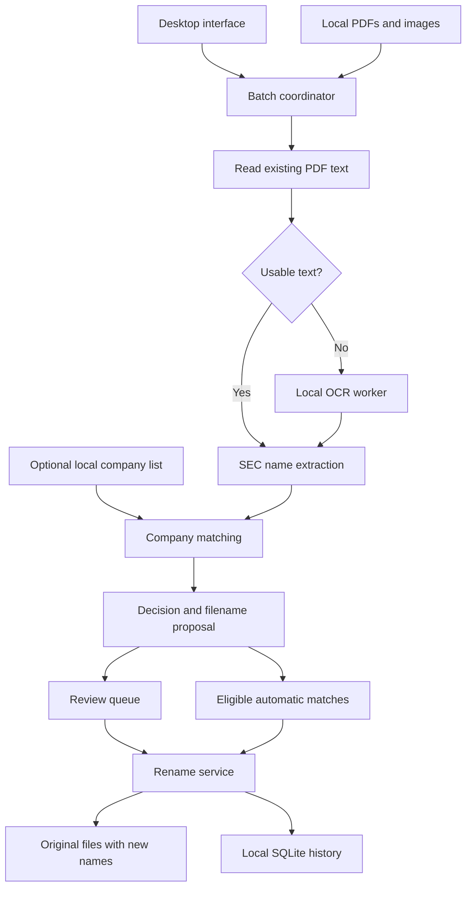

# Local SEC document renamer — implementation plan

> The current consolidated decisions are in [APP_SPECIFICATION.md](./APP_SPECIFICATION.md). That plan supersedes conflicting historical proposals below, including Android-only scope, unapproved Kotlin selection, and in-place renaming.

> Implementation update: the Kotlin/Compose Android demo now builds, 19 tests pass, and verified-copy export replaces the old in-place rename flow. The toolchain/compilation limitations described below are historical. Physical-device validation is the next step; see [DEMO_GUIDE.md](./DEMO_GUIDE.md).

## Goal and scope

### Latest requirement: preserve originals and export renamed copies

This requirement supersedes every in-place rename description elsewhere in this document. Users select a source folder and a separate output location. The application creates a new batch subfolder in that output location and writes renamed copies there. It never renames, moves, deletes, or modifies source documents. The existing Java feasibility prototype performs in-place rename and must not be used for the revised workflow until replaced. Android and Windows standalone applications are now under consideration together; Kotlin Multiplatform with Compose Multiplatform is the recommended candidate, not yet an approved stack decision.

#### User flow

1. Select the local source folder; recursion is off by default.
2. Select a distinct local output parent. Reject the source itself and output nested within the source; verify resolved paths/URIs where the platform permits and report locations that cannot be safely distinguished.
3. Analyze source files and show original name, proposed company name, output name, evidence, and review status. Importing a company list remains optional.
4. Show a batch summary and estimated output size. User starts export for reviewed documents; automatic eligibility remains gated by validation.
5. Create a uniquely named batch output folder. For each accepted file, allocate a collision-free name using `(1)`, `(2)`, etc. Unresolved files remain pending in the review queue; do not silently omit them from the summary.
6. Copy the original bytes to a temporary destination, compute a SHA-256 digest while reading, reopen the completed output and verify its digest, then publish the final filename only after successful verification. Detect source changes during processing and fail or reanalyze rather than associating a stale OCR result with new bytes. Preserve the original extension and original file contents; OCR derivatives are not the exported source copy.
7. Persist pending, copied, verified, completed, failed, and uncertain states. Report counts and exact failure reasons. On restart reconcile incomplete entries; do not assume a provider operation is atomic or successful solely because it returned.

#### Output and recovery rules

- Never overwrite source files or existing output files, including under same-batch collisions. Use exclusive creation where supported. On Android validate actual provider-returned names and capabilities; do not promise atomic publication on all providers. Restrict initial support to tested local storage providers.
- Check free space when available and handle disk-full, permission revocation, locked inputs, cancellation, and disconnection per file. Stop safely at file boundaries. Never mark unverified partial output as complete.
- The application writes a private batch journal before output operations. It tracks source/output identifiers, chosen names, timestamps, verification digests, result status, and rule/app version without full OCR text. Paths and company names in this journal remain sensitive.
- Keep source copies independently of the export lifecycle. Removing a batch export, if offered later, requires explicit confirmation and must operate only on verified application-created outputs. Initial release provides no automatic cleanup of originals or completed exports.
- Repeated exports and resume behavior must be explicit: resume the selected incomplete batch or start a new batch. Do not silently reuse files based only on their filenames.

#### Security and backup design

- Local processing, bundled OCR data, no cloud endpoint, telemetry, email integration, or automatic synchronization. Verify packaged permissions and offline behavior on both targets. Users should choose bank-approved local locations; synced folders/providers may upload independently of the app.
- Disable Android app-data backup for the initial release, keep journals in app-private storage, exclude OCR text and temporary page images from routine logs, and remove temporary derivatives after processing under a documented retention policy. This is normal deletion, not a guaranteed forensic erase on flash storage.
- Use bank-managed device/storage encryption and screen locking. Exported files inherit their destination's access controls; application-private storage does not protect a user-selected shared output folder. Consider app reauthentication after inactivity if required by bank policy, rather than introducing a separate password store by default.
- Grant access only to selected locations using platform facilities. Android document providers may require broader grant flags than read-only source access; regardless of grants, the source service must expose read/list operations only and must never call rename/delete/write for source documents.
- Treat PDFs, images, and spreadsheets as untrusted inputs: validate supported types, impose file/page/pixel limits, handle malformed/password-protected documents, and keep parsing dependencies patched. Do not execute document scripts or macros.
- Document dependency licensing and pin versions. Google ML Kit is proprietary; evaluate it against bank policy and an open-source alternative before final selection. Signing keys and release artifacts need controlled storage and distribution.
- Source preservation is a recovery safeguard, not an independent backup. Copies on the same device remain vulnerable to device failure or ransomware. Separate encrypted backups, retention, and restore testing belong in the bank's existing approved backup process; do not add cloud transfer automatically.
- Local history supports traceability but is not a tamper-proof audit trail. Stronger centrally managed audit requirements would need a separately agreed design.

#### Revised acceptance checks

- Before/after source-folder snapshots show identical names and content hashes, including failure and cancellation cases.
- Each completed output is byte-for-byte identical to the source used for analysis; duplicate names never overwrite another output.
- Same-folder/nested-folder selections, disk-full, permission loss, interrupted copies, source changes, corrupted inputs, and uncertain provider responses produce recoverable and accurately reported states.
- Verify resumed batches without recopying completed items incorrectly, and confirm no sensitive OCR text appears in routine logs or backups.
- A release APK/desktop build must pass offline operation checks; current source has not been compiled or device-tested.

Automatically rename scanned SEC documents using the certificate holder's company name. Document processing, OCR, review, company matching, and history stay on the local computer. Version one accepts PDFs, JPGs, and PNGs, with one certificate/company per file. Multiple companies or certificates in one file are flagged for review; PDF splitting is outside the initial scope.

The company list is optional. Import it later from a locally saved CSV or XLSX attachment; there is no email integration. Names and examples in the mockup are fictional.

## Platform decision: standalone Android first

### Current implementation status

The first native Android prototype source is now present under `app/`. It implements local-folder selection, bundled Latin OCR for PDFs/images, conservative certificate-name extraction, editable review, duplicate filename proposals, explicit rename confirmation, and a pending-operation journal. The feasibility implementation uses Java/native Android widgets rather than Kotlin. Google ML Kit is the current bundled OCR dependency; it is not open source and remains subject to bank approval or replacement.

Compilation and device validation are pending because no JDK, Gradle, Android SDK, or adb was discovered in the development environment. No APK has been produced. Company-list import, batch OCR, embedded document preview, undo, and automatic eligibility remain future milestones. See [README.md](./README.md) for build steps and limitations.

The first implementation target is a standalone Android application. The earlier Windows proposal below is retained as background only and is not the active implementation stack. A desktop edition is deferred. There is no local web server, hosted application, or dependency on a bank computer.

### Android architecture and implementation approach

- Build a native Android interface and application core in Kotlin. Select specific PDF/image files or a folder through Android's system picker.
- Evaluate and bundle an on-device OCR engine and all required recognition data with the application. Verify the chosen library's current APIs, licenses, Android support, and installation footprint before committing to it. The desktop OCRmyPDF/Python stack is not assumed portable to Android.
- Render scanned PDF pages locally for OCR; evaluate text extraction for PDFs that already contain usable text. Process pages incrementally to limit memory use.
- Keep extraction templates, name normalization, company-list schema, and naming rules platform-independent where practical. Validate with shared fictional test fixtures.
- Store decisions and rename history in an application-private local database. Import optional CSV/XLSX company lists using the system picker; validate spreadsheet-library compatibility during the dependency spike.
- Access documents through granted document URIs rather than assuming ordinary filesystem paths. Check whether the selected storage provider supports rename. Report unsupported operations instead of silently copying/deleting files. Reconcile returned URIs after a rename.
- Apply `(1)`, `(2)`, etc. within the selected destination, checking provider behavior and collisions. Test recovery and undo on supported storage providers; do not assume filesystem-style atomic rename guarantees.
- Require a local device-storage location for the local-only workflow. Cloud-backed document providers may themselves transfer data, even when the app performs OCR on-device.
- Keep the interface responsive during batches, allow cancellation between files, and persist progress for interruption recovery. No email integration or automatic document synchronization.

### Android screens

1. **Home:** select documents/folder, optionally import a company list, and start analysis.
2. **Batch results:** scrollable document cards, proposed company names, status filters, progress, and review actions.
3. **Review:** zoomable page preview above the extracted evidence, editable company name, and proposed filename. Approve, skip, and next actions fit a phone screen.
4. **Company list:** import, map columns, inspect duplicate names and aliases, and recheck unresolved documents.
5. **History:** inspect completed batches, preview undo, and resolve permission or naming conflicts.

### Revised delivery milestones

1. Android feasibility spike: build and install a minimal APK; verify bundled offline OCR, local PDF rendering, document permissions, and provider rename behavior on a real device.
2. Extraction prototype with fictional samples, evidence display, and review-only filename proposals.
3. Optional company-list import, matching, duplicate numbering, and phone review interface.
4. Real rename execution, local journal, interruption recovery, and conflict-aware undo.
5. Representative certificate validation, offline/airplane-mode checks, memory and large-batch tests, and installable APK delivery. Enable automatic eligibility only after validation.

The acceptance checks below continue to apply, with Android document-provider semantics replacing Windows filesystem assumptions. No application implementation has been completed yet. The HTML preview now presents a phone-sized Android design with Batch and Review tabs, editable proposals, and simulated approvals; it is not the Android app.

## Earlier desktop proposal (reference only)

### Proposed technology

- Python application core and PySide6 desktop interface: folder selection, tables, previews, and background jobs without a hosted service.
- OCRmyPDF/Tesseract for scanned PDFs; local Tesseract for images. Produce OCR derivatives in a local temporary directory, leaving source bytes intact.
- A PDF text/layout reader, initially evaluated with pypdfium2, to recover text and render previews.
- Small SEC-specific extraction templates using surrounding phrases and layout. Evaluate invoice2data reuse in the first technical spike; use it only if adapting its invoice schema is simpler than a small extractor.
- Python CSV reader and openpyxl for optional company imports. RapidFuzz can suggest approximate matches; approximate matching alone does not authorize automatic renaming.
- SQLite for batch decisions and reversible rename history. Native filesystem rename operations with explicit collision handling.
- A packaged Windows application after dependency and offline installation validation. Pin versions and review dependency licenses before distribution. OCR runtime packaging is a milestone, not assumed solved by packaging Python alone.

These are proposed dependencies, subject to a short compatibility and installation check on the bank-approved Windows environment.

## Processing and decisions

1. Select a folder or explicit files; scan subfolders only when selected. Start with a batch action, not a continuously watched folder.
2. Read text, falling back to local OCR when insufficient. Run expensive work in a worker process so the interface remains responsive and cancellation is possible between files.
3. Identify certificate context, then collect name candidates from anchor phrases, nearby text blocks, multiline continuation, and supporting suffix clues. Do not select a name based solely on uppercase letters or company suffix.
4. Preserve original extracted spelling. Normalize case, spacing, and punctuation only for comparison. Company-list records contain `company_name` and optional `aliases`; duplicate or ambiguous normalized names require review.
5. Use a clear decision reason: ready for review, ambiguous name, unreadable scan, multiple companies, unknown company, or processing error. Show evidence from the document beside the candidate.
6. Initially require review for all proposals. Enable automatic renaming only after validation establishes reliable extraction rules. Without a list, automatic eligibility requires validated certificate-context rules. With a list, require an unambiguous name match plus certificate-context evidence. Fuzzy matches remain suggestions. A score is not presented as a calibrated probability.
7. Recheck unresolved files after importing a company list without repeating OCR when retained local extraction data is available.

## Naming and reversibility

- Use the accepted company name, preserving the original file extension: `ABC CORPORATION.pdf`, `ABC CORPORATION (1).pdf`, `ABC CORPORATION (2).pdf`.
- Sanitize Windows-invalid characters, reserved names, trailing dots/spaces, and excessive path lengths. Show any sanitization in preview.
- Resolve collisions case-insensitively against existing files and planned names in the same destination folder. Recheck at execution; never overwrite. A repeated run on an already named file is a no-op.
- Rename within the source folder by default. Do not modify document contents or overwrite source files with OCR output.
- Record original path, new path, batch, time, decision source, and execution status. Handle interruption using a pending journal entry and reconciliation on restart.
- Undo only if the current file still matches the recorded file identity/content check and the original path is free; otherwise show a conflict.
- Report locked files, permission failures, corrupted files, and encrypted PDFs per file without stopping the whole batch.

## Interface design

### Batch screen

Folder picker, optional company-list import, Analyze button, summary counts, and result table. Columns: original filename, extracted company, proposed filename, decision, and reason. Filters: all, ready, needs review, renamed, failed.

### Review workspace

Selected document preview on the left; extracted name, nearby OCR evidence, suggested company-list matches, editable accepted name, and proposed filename on the right. Actions: approve, skip, next. Do not automatically open files in an external service.

### Company list

Import CSV/XLSX, preview columns, map official name and optional aliases, validate duplicates, and replace the active list explicitly. Existing completed renames remain unchanged unless a user starts a new review.

### History and settings

Batch history with undo preview and conflicts. Settings for OCR language, temporary-data retention, folder recursion, and automatic-renaming eligibility. Keep full OCR text out of routine logs. History and company lists remain sensitive local data under existing bank access controls.

## Delivery milestones

1. **Extraction spike:** confirm Windows OCR installation; process synthetic and bank-approved representative samples. Deliver extracted names, evidence, and known limitations without renaming.
2. **Core workflow:** PDF/image input, extraction, optional CSV/XLSX imports, filename proposals, duplicate allocation, and meaningful tests for matching and rename safety.
3. **Desktop interface:** batch table, document preview, editable review, progress, cancellation, and error reporting.
4. **Rename and recovery:** no-overwrite execution, persistent journal, restart reconciliation, and undo with conflict checks.
5. **Validation and packaging:** validate on representative certificates, tune eligibility, package Windows installer/offline dependencies, and verify operation with outbound network blocked.

## Acceptance checks

- Full processing works without internet after installation; no cloud OCR, external model, telemetry, or email integration is required.
- The workflow works before a company list is available and can import one later.
- Test certificate layouts, multiline names, similar names, OCR errors, multiple-name documents, and absent company names.
- Measure extracted-name accuracy, incorrect automatic renames, and review rate on a labeled sample set. No blanket accuracy claim before this evaluation. Agree automatic eligibility based on observed errors; keep review as default until then.
- Duplicate filenames never overwrite files; include existing numbered files and same-batch collisions.
- Source file contents remain unchanged, repeated runs do not add duplicate suffixes, and safe undo restores names.
- Locked files, cancellation, and interrupted batches remain recoverable.

## Visual prototype

Open [UI_PREVIEW.html](./UI_PREVIEW.html) in a browser. It is a self-contained design mockup with fictional data; filters, row selection, and a simulated approval demonstrate the intended interaction. It does not read or rename real files. The actual application is planned as a desktop program.

## Inputs needed during implementation

Representative approved samples to validate layout rules, expected batch sizes and Windows restrictions, and the company list when available. These do not block the initial synthetic-data prototype. Sensitive documents should remain in the bank-approved environment.
